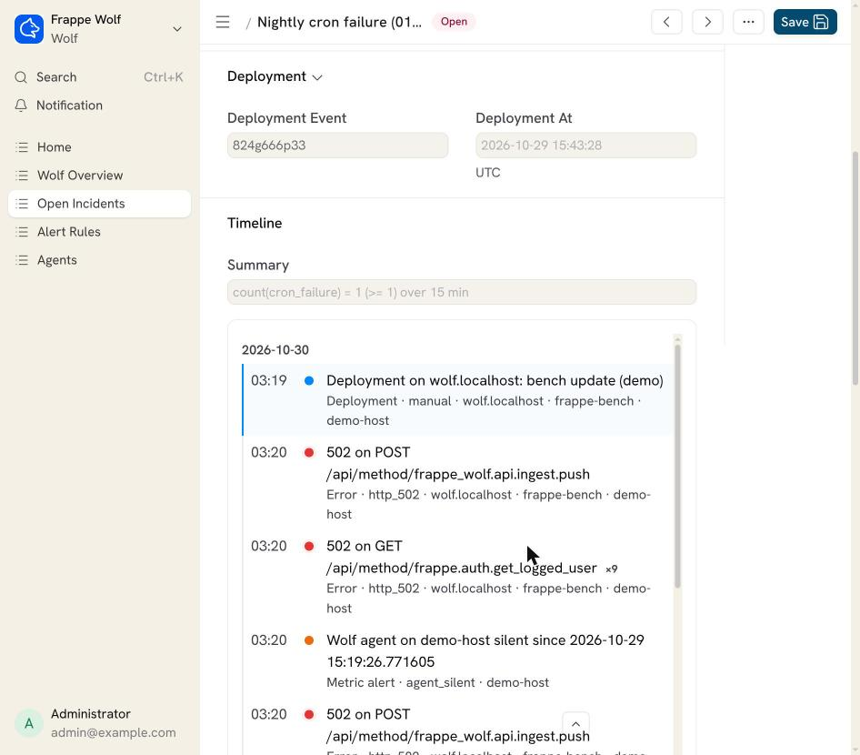

# Local demo: the 2AM scenario from CLAUDE.md

One Dokos bench with `frappe_wolf` on the site `wolf.localhost`, plus:

- an nginx front that logs the site name;
- the Wolf agent, tailing the bench and nginx logs and Redis;
- a webhook sink that prints every alert.

Everything runs locally; nothing leaves your machine.

```bash
cd dev/demo
# Any Dokos image works as base; reusing a local one avoids a multi-GB pull.
WOLF_DEMO_BASE=registry.gitlab.com/dokos/dokos:latest docker compose up -d --build
docker compose logs -f agent          # wait for "wolf-agent 0.1.0 started"
python3 scenario.py                   # ~5 minutes
docker compose logs catcher           # the alerts Wolf sent
```

Desk: <http://localhost:8099/app/wolf-overview>, login `Administrator` / `admin`.

## What `scenario.py` does

1. Keeps the site time zone if it is already night there; otherwise switches to a real zone
   where it is between 01:00 and 04:00 (e.g. Asia/Shanghai). This moves the site clock "into
   the night" without faking the system clock. Prefer moving the clock forward: switching to
   an earlier zone leaves future-dated rows behind (see Setup wizard below).
2. Adds a webhook channel (`http://catcher:9999/`) to the 502 and scheduler preset rules.
3. Marks a deployment with `wolf-agent mark-deployment`.
4. Stops the backend for 60 s while sending traffic, so nginx answers 502.
5. Starts the backend again and reloads nginx.
6. Adds a Server Script scheduled job that fails every minute ("Nightly ledger sync"), lets it
   fail, then disables it.
7. Prints the incidents.

Expected:

- **502 spike after deployment**: critical, with the deployment linked.
- **Nightly cron failure (01:00-04:00)**: critical. It is reported by the site itself, through
  Wolf's `Scheduled Job Type` override. The agent's `scheduler.log` parser stays quiet here:
  Frappe logs "Scheduled Job Failed" at INFO, below the default logger level.
- One webhook per new incident.

Presets like **Disk almost full** may fire too, because the agent measures the machine
running Docker. **Agent silent** fires once as an artefact of step 1: `last_seen` was stored
in the old time zone, so the agent looks hours stale for one check.



## Setup wizard

`create-site` marks setup as complete, so Desk opens directly. To go through Dodock's wizard
instead (language, country, time zone, currency, first user), reset the flags and open
<http://localhost:8099/app>:

```bash
docker compose exec backend bash -c "cd ~/frappe-bench && \
  bench --site wolf.localhost execute frappe.db.set_single_value --args '[\"System Settings\", \"setup_complete\", 0]' && \
  bench --site wolf.localhost execute frappe.db.set_value --args '[\"Installed Application\", {\"app_name\": \"frappe\"}, \"is_setup_complete\", 0]' && \
  bench --site wolf.localhost execute frappe.db.set_default --args '[\"desktop:home_page\", \"setup-wizard\"]' && \
  bench --site wolf.localhost clear-cache"
```

Two things to watch:

- **Browser autofill.** Chrome may fill and submit the account step with your own name,
  email and saved password. Turn autofill off for localhost, or check the fields before the
  wizard moves on.
- **Time zone.** The wizard replaces the time zone that `scenario.py` set. Rows recorded
  under the night zone are then stamped hours in the future and skew rule windows until real
  time catches up. Frappe's own scheduler stalls the same way: every Scheduled Job Type's
  `last_execution` is in the future, so no job is due. Delete the future rows and set those
  `last_execution` values to now, or reset the stack.

## Email and Raven channels

```bash
WOLF_DEMO_RAVEN=1 docker compose up -d --build     # adds Raven (backend only) to the image
docker compose exec backend bench --site wolf.localhost install-app raven
python3 channels.py
```

`channels.py` sets up the following on the **Scheduler failure** rule, then makes a job fail:

- an outgoing Email Account pointed at Mailpit;
- a Raven workspace and a `wolf-alerts` channel;
- Email, Raven and Webhook channels on the rule.

Mail shows up at <http://localhost:8025> within one email-queue flush, a few minutes at most.
Raven is installed without `blurhash-python`, which has no Python 3.14 wheel; that only
affects image previews.

## Database portability check

[`ci/db_smoke.py`](../../ci/db_smoke.py) (mounted at `/etc/wolf/db_smoke.py`, also run by CI) runs every Wolf SQL path on a site: ingest, dedupe, all rule kinds, correlation,
timeline, charts, purge and auto-resolve. It works the same on MariaDB and on Postgres:

```bash
docker compose exec backend bash -c 'cd sites && ../env/bin/python /etc/wolf/db_smoke.py wolf.localhost'
WOLF_DEMO_PG_IMAGE=postgres:16 docker compose --profile postgres up -d pgdb
docker compose exec backend bench new-site pg.localhost --db-type postgres --db-host pgdb \
  --db-root-username postgres --db-root-password admin --admin-password admin --install-app frappe_wolf
docker compose exec backend bash -c 'cd sites && ../env/bin/python /etc/wolf/db_smoke.py pg.localhost'
```

Reset: `docker compose down -v`.
