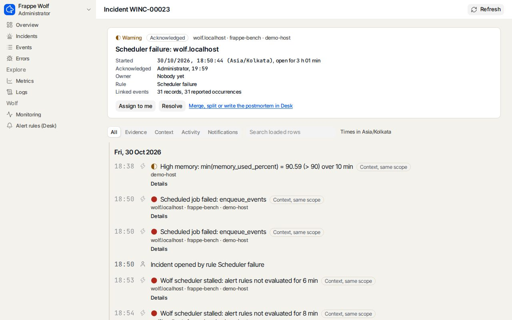
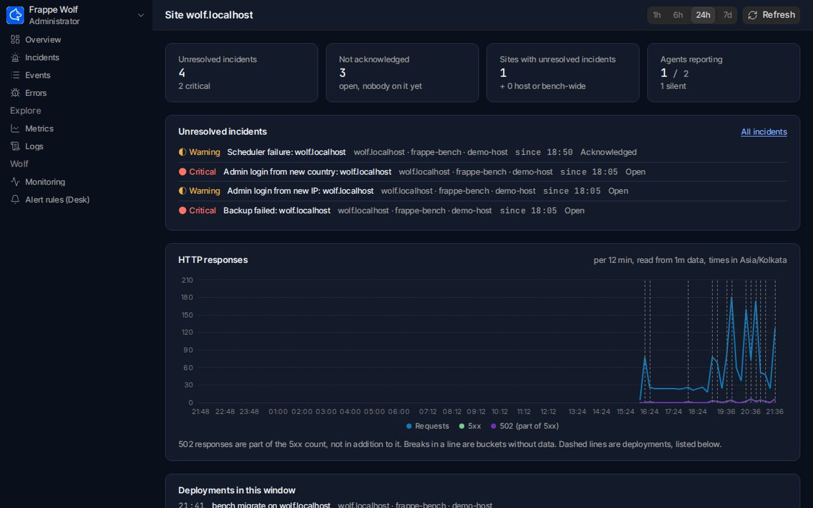
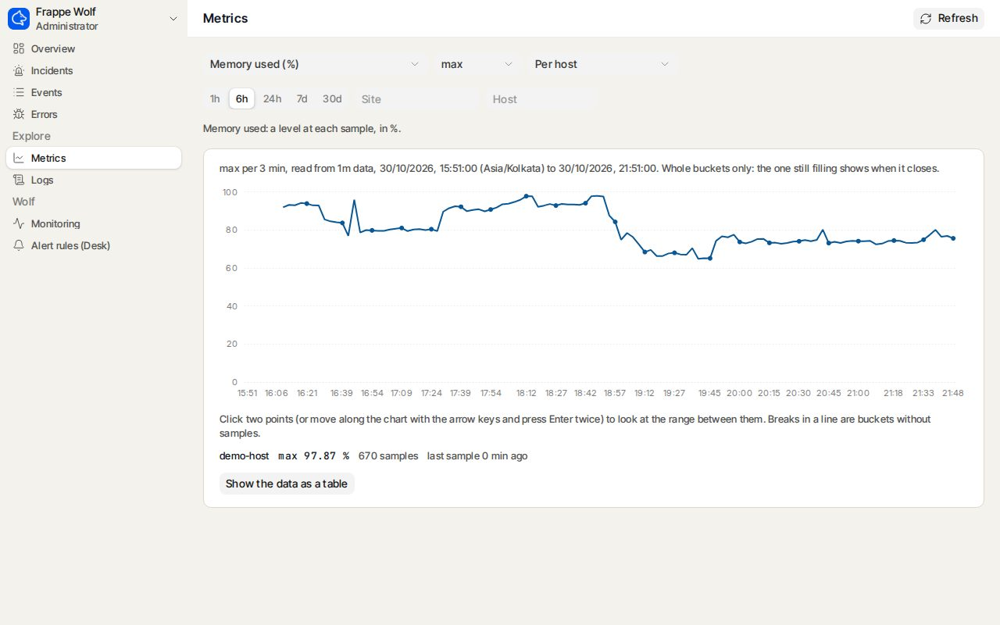

# Making Frappe Wolf

> *The night shift never sleeps.*
> The full, art-directed version of this story is in [`index.html`](index.html). The identity tokens are in [`brand.md`](brand.md).

## 01 · The brief

Dokos wanted first-class observability for Frappe benches, ERPNext and Dokos sites, Pilot benches
and their Linux hosts. It had to use open formats and self-hosted storage, and be adoptable in one
afternoon. The brief also listed non-goals: no Datadog clone, no LLM observability, no SLO
cathedrals, no RUM. Our acceptance test came from its own words:

> “The team wakes up with a clear incident timeline, not a surprise email from the customer at 9AM.”

## 02 · The idea

We didn't want another all-seeing eye. A **wolf** works the night shift. It hunts as a pack, the
host agent and the site app being two halves of one animal. And it howls once. That gave the
product its rules of behaviour: listen widely (logs and `/proc`), group before you shout
(correlate events into one incident per scope), and notify on open, reopen and resolve, never on
every event.

## 03 · Naming and voice

The product is *Frappe Wolf*, made of the *Wolf Agent* on the host and the *Wolf App* on the
site. The DocTypes keep sober names, because operators type them at 2AM. The voice is that of a
good on-call colleague: state facts, lead with scope, prefer numbers to adjectives, put the link
last, and use one wolf metaphor per screen at most.

## 04 · Identity


The founder's mark is used as supplied: a wolf head in profile drawn as a single white line, with
an angular eye slit, on an electric blue (`#035AEC`) rounded square. The palette is rebuilt
around that blue. It is the only brand colour, used for the tile, links and focus. Neutrals are
*Os* (`#F4F2EC`) and *Nuit* (`#0A0F1C`). Severity is encoded as **moon phases**, so it survives
colour blindness, greyscale and forwarded emails:

| | info | warning | critical | resolved |
|---|---|---|---|---|
| Glyph | ○ new moon | ◐ half moon | ● full moon | ✓ ring |
| Light | `#6B4FA0` | `#8A5200` | `#B0281C` | `#2E6B4A` |
| Dark | `#BBA6E6` | `#F0B04A` | `#FF7466` | `#7CC79E` |

Info is lilac moonlight, not blue, so a deployment marker never reads as the brand or as a link.
Amber means only *warning*. Logo rules (clear space, minimum size, don'ts) are in
[`brand.md`](brand.md). Type: **Instrument Serif**, **Inter Tight** and **JetBrains Mono**.

## 05 · The hero object: the incident timeline

Dashboards answer "how are things?". After a bad night the question is "what happened, in what
order, and was it the deployment?". The incident timeline answers it: every event in the
incident's scope on one rail. Illustrative example from the brief's demo scenario:

```
01:47  ○  Deployment on main: bench update
01:48  ●  502 on GET /api/method/… ×14                 nginx
01:50  ●  Incident opened, deployment linked           sum(http_502) ≥ 10 / 5 min
01:50  ◐  Notified: email + Raven
02:00  ●  Scheduled job failed                         scheduler.log
02:00  ◐  Correlated into the same incident, no second howl
   …   seven quiet hours
08:55  ✓  Acknowledged by the morning team
```

*Status:* built, in Desk and in the Wolf UI (`/wolf/incidents/<name>`). The Wolf UI's rail
interleaves four families: linked evidence, context from the same scope, operator activity and
notification attempts. Each row has a stable id. Pages come back identical whatever their size,
even when rows share a timestamp. The rail stays honest:
- a deployment before the incident is a *preceding change*, never its cause;
- a deduplicated event is one row with its count, not one row per repeat;
- a notification is *accepted by the endpoint*, which is not someone having read it;
- a long silence is *no recorded activity*, never "healthy".



## 06 · Information architecture: three rooms, then a few more

The daily views moved out of Desk into the Wolf UI at `/wolf` (#19). It's a frappe-ui app on
the same session and permissions. Desk keeps configuration.

1. **Overview** (built): exact counts, never the length of a list on screen. Then the newest
   unresolved incidents, HTTP responses with deployments marked, and every signal: workers,
   Redis, database, backups, TLS, host. Each signal is in one of five states that are never
   merged: missing, stale, unwatched, within its rules, firing. The same page serves each site,
   host and bench. A bench is always addressed through its host.
2. **Incident** (built): the timeline of chapter 05, scope first, with acknowledge, assign and
   resolve when the server allows them. Merge and split too, once the server has said what
   would move. The postmortem starts there and is written in Desk.
3. **Alert Rule** (built, in Desk): a form that reads like the brief's sentence, *when X > Y for
   Z minutes, send alert*. "For Z minutes" is the `min` aggregation over the window.

Explorers came after the rooms:
- **Events**: deduplicated records with their counts;
- **Errors**: grouped by fingerprint;
- **Metrics**: the catalog decides how a metric may be read. A disk level is averaged, a count
  of 5xx responses is summed, and a sum of disk levels is refused.

Every page says what it read: window, resolution, buckets, retention, what was left out. **Logs**
explains why there is no log search yet: Wolf stores parsed events, not raw lines.





## 07 · The protocol is an interface

`docs/protocol.md` was written before any code, because the agent and the app were built in
parallel. Its design decisions:

- UTC on the wire, local time in the UI.
- The secret is shown once and rotated on re-register. Registration is rate-limited.
- Aggregate at the edge: counts per interval, not a firehose.
- Fail closed (401/403 stops the agent) and retry open (spool to disk with backoff on 5xx or network errors).
- Two small vocabularies: six event types and a dozen metrics. Nuance goes into `category`.

## 08 · Build log

Append new entries at the bottom. Mirror them in `index.html` (`#build-log`).

- **2026-10-29 · Brief**: CLAUDE.md adopted as the source of truth.
- **2026-10-29 · Protocol**: v1 written before code (`docs/protocol.md`).
- **2026-10-29 · Data model**: seven DocTypes generated from one spec.
- **2026-10-29 · Core**: `schema.py` and `conditions.py` kept free of Frappe imports, so they can be tested without a bench.
- **2026-10-29 · Engine**: ingest API, rule engine (metric/event signals, deployment gating, cooldown, auto-resolve), correlation, and email/webhook/Raven delivery.
- **2026-10-29 · Agent**: stdlib-only daemon with collector, rotation-aware tailer, parsers, Redis RESP client, spooling shipper, `install.sh` and a systemd unit.
- **2026-10-29 · Desk**: overview page, incident timeline, workspace, Dokos presets, local signals.
- **2026-10-29 · Identity**: official logo adopted. The palette was rebuilt around `#035AEC` and info moved to lilac.
- **2026-10-29 · Publishing**: making-of published on [GitHub Pages](https://bthuner.github.io/frappe-wolf/) (`docs/making-of/`, relative assets, OG image).
- **2026-10-29 · Alerting that holds**: an agent watchdog that alerts through its own channel when the site stops working, alert quality (flapping, cooldowns, digests), native channels (Slack, Mattermost, Matrix, ntfy, Gotify, SMS, PagerDuty), and the incident workflow (assignee, comments, merge and split, postmortems, MTTA and MTTR).
- **2026-10-29 · Press and Pilot**: benches discovered on Press servers and from Pilot's `bench.toml`. Their deploys and migrations become deployment events.
- **2026-10-29 · Privacy and access**: PII scrubbed on the host, per-site, bench and host grants for Wolf Users, hashed agent secrets, a push rate limit, and a clock-skew guard.
- **2026-10-29 · Signals**: RQ registries, queue Redis, backups, TLS expiry, MariaDB, bench processes, the email queue and GeoIP for logins.
- **2026-10-30 · Storage that scales**: minute and hour rollups with retention per resolution, reads that pick the resolution of their window exactly across raw and rolled data, and async ingest. A queued push that fails is retried and logged. A backlog shows in Wolf's health.
- **2026-10-30 · Wolf UI shell**: a frappe-ui app at `/wolf` for daily operation (#19), with the Frappe session, light and dark themes on the brand tokens, and access checks. A view not built yet says so and links to Desk.
- **2026-10-30 · Exact counts**: overview numbers computed with the reader's access rules, never from a list on screen. An inventory of hosts, benches and sites says where each one came from.
- **2026-10-30 · Incident page**: the timeline of chapter 05 in the Wolf UI, paged with a cursor, with actions checked against the incident's state on the server.
- **2026-10-30 · Dashboards**: overview, site, host and bench pages. Signals in five honest states, and HTTP with gaps kept and deployments marked.
- **2026-10-30 · Explorers**: events, error groups and metrics. The catalog governs how a metric is read, two points on a chart become a window, and every chart can be read as a table.
- **2026-11-01 · Browser and accessibility tests**: every view of the production build in Chromium, API mocked in the page, axe (WCAG 2 A/AA) in the light and dark themes, keyboard, reduced motion. They found two contrast failures (sidebar section labels, dimmed timeline times), now fixed.
- **2026-11-01 · Live updates**: invalidations over Frappe's socket.io, in rooms Frappe guards with the reader's permissions; pages refetch, never scroll on their own, and poll when there is no socket.
- **2026-11-01 · Focus restoration**: each page has a real `<h1>`, and a route change moves focus there. A button that frappe-ui disables while it works (Refresh, Comment) gets the focus back; an action that goes away (Acknowledge, Approve…) hands it to what is left nearby. Measured in Chromium before the fix: focus fell to `<body>`, and Tab started again from the top of the page.
- **2026-11-01 · Live check on the demo bench**: the demo stack in Docker, the 2AM scenario walked in the Wolf UI only (owner, evidence, webhook result, resolution), live updates over the real socket.io server with a site-scoped user refused the room of an incident outside its scope, and screenshots of real data in both themes. It found four faults the mocks could not: live updates never connected behind the demo's nginx, an incident linked a deployment made after it started, the scenario could stall Frappe's scheduler for hours by moving the clock back, and a stopped backend gave a handful of 502s instead of a window of them.
- **2026-11-01 · Merge and split in the Wolf UI**: dialogs that ask the server what would move (events, comments) and what each incident becomes, before anything does; the same checks as the actions themselves. The postmortem starts from the incident page and is written in Desk.
- **2026-11-01 · Every state of every view**: a browser test walks each view through loading, empty, filtered-empty, error, forbidden, partial, stale and disconnected. It found that most views showed nothing while loading, the incident page not even a busy button; that a refusal showed Frappe's "Not permitted"; that the timeline said "Nothing recorded" under its own error; and that the incident page's load error was not announced.
- **2026-11-01 · Load test, 100 hosts × 7 days**: about 20 M rows on the demo bench. The push holds (p95 115 ms over HTTP), but the Wolf UI's overview does not: inventory and signals take 13 to 24 s. Rows named by random hash scatter a day of rollups over the whole table, the default 128 MB buffer pool holds none of it, and MariaDB picks an index that cannot use the time range. Measured, written down, not fixed yet.
- **2026-11-01 · Rows in metric order**: InnoDB stores rows in name order, so metric rows are now named by resolution, metric and time, and inserted in that order. One more index lets the inventory read the index alone. A first try put the whole metric name in the row name: since every index entry repeats the name, the table grew by half and filled the bench's disk. Names now stay 33 characters, as long as the hash they replace. The Wolf UI's overview went from 13 to 24 s down to 1.5 s at the default 128 MB cache, the 24 h rule from 11.4 s to 0.9 s. The rest is CPU, not disk, and no index will shorten it.
- **2026-11-01 · Reads in SQL**: reads of known metrics scan the primary key by name range, and chart buckets are summed by the database instead of 144 k rows merged in Python. A full run on fresh data then found `get_signals` at 194 to 233 s: MariaDB had turned the join that picks each series' newest value into a lookup per series, each walking a metric's whole minute rollups. Runs on older data had shown it once, taken for an outlier. `row_number()` reads the rows once: 0.62 s. Every Wolf UI read is now under 1 s at 100 hosts, the slowest at 0.73 s, and Desk's 24 h chart at 0.56 s. A review fix meant to keep old-named rows off the primary key was measured slower (1.15 s against 0.77 s) and taken back.
- **2026-11-01 · The page in a browser**: `/wolf` opened in Chromium on the bench, timed from navigation start until every panel is drawn. 0.9 to 1.0 s at the median, 1.0 to 1.3 s at p95: the two slow reads (0.5 to 0.6 s each, side by side) and drawing 300 signal rows (0.1 to 0.3 s). The first try timed the wrong site: the demo's nginx serves one site whatever the host name, and the numbers were too good to be true.
- **2026-11-01 · A short cache, shared and filtered**: the inventory and signals keep what they read for 30 s. What is cached is read without access conditions, the same for everyone; each request keeps what its caller may see, so no cache entry carries one user's rights to another, and a smoke check proves it with a host-scoped user. Rules and incidents stay per request. A page served from the cache is drawn in 0.53 s, p95 0.61 s. The first "cached" run was not: Dodock's web workers keep the site config for a minute, and still read the cache as off.
- **2026-11-02 · Read again in the background**: a cached value past its 30 s is still served, up to 2 min, while one deduplicated job reads it again; every minute the scheduler reads again what was asked for in the last 10 minutes. Pages opened 45 s and 150 s apart were all served from the cache (max 0.65 s), with data 11 to 51 s old. The new job only ran once Frappe's cached hooks were cleared: `bench migrate` does that on a site, a copied `hooks.py` does not.

## 09 · Trade-offs

- **Python, not Rust, for the agent:** contributors can read it on day one. The protocol allows a Rust agent later.
- **DocTypes, not ClickHouse:** storage you already back up, with retention settings.
- **Thresholds, not ML:** a rule you can read is a rule you can trust at 2AM.
- **Desk, not a separate SPA** (superseded by #19): no new logins, native permissions. The daily operator views now live in a frappe-ui app at `/wolf` that reuses the Frappe session and permissions; Desk keeps configuration.
- **Honest numbers over pretty ones:** a gap stays a gap, a missing signal is not a zero, a repeat count is not a count for the window, and a past window is not "stale". Every page says what it read. A chart that looks calm because it hides what it doesn't know would wake no one at 2AM.

## 10 · Next

- **Log search:** waits for raw-line storage, which Wolf deliberately doesn't have yet.
- **A real Press server and Pilot host:** the integrations still need to run on one.
- **The overview's first visit at 100 hosts:** a visit the background reads do not cover (the first in 10 quiet minutes on a scope) still takes 0.9 to 1.2 s ([`docs/load-test.md`](../load-test.md)). Drawing the first signal rows and hosts only halves the drawing on a load bench (0.10 to 0.05 s cold).
