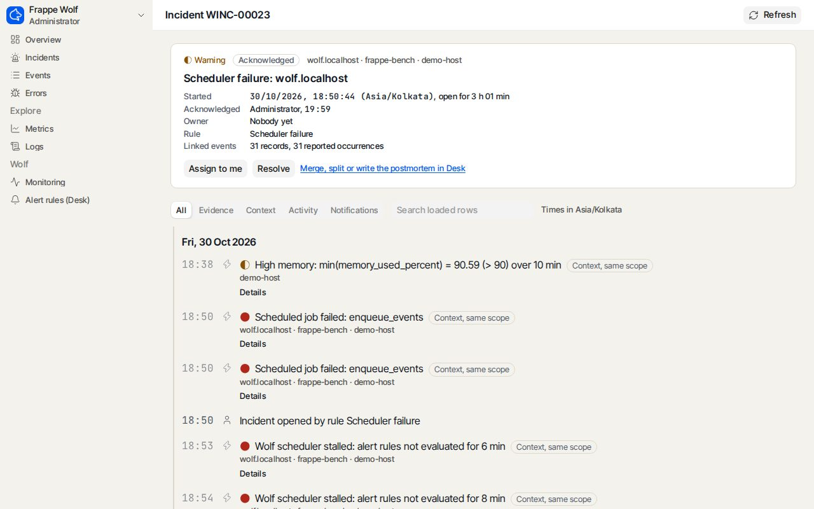
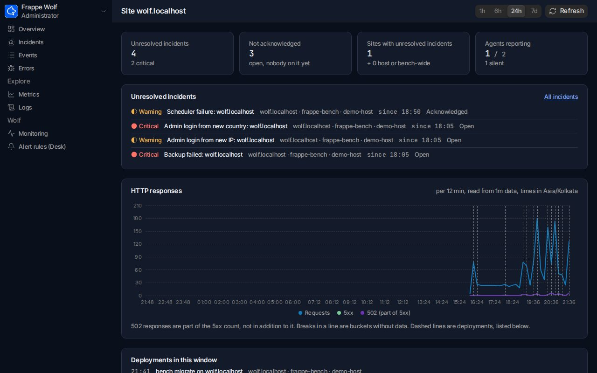
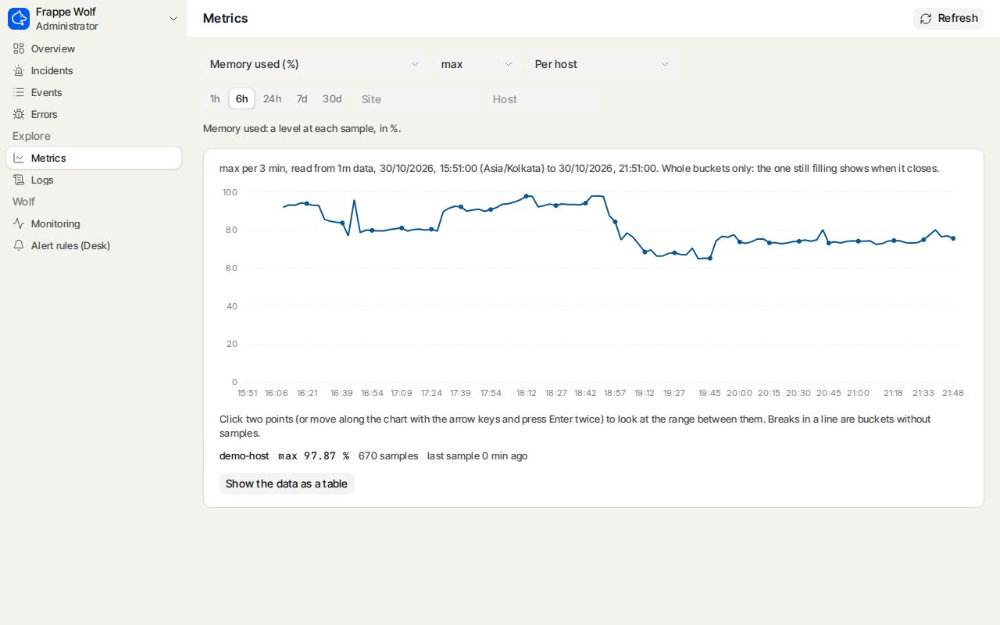

# Making Frappe Wolf

> *The night shift never sleeps.*
> The full, art-directed version of this story is in [`index.html`](index.html). The identity tokens are in [`brand.md`](brand.md).

## 01 · The brief

Dokos wanted first-class observability for Frappe benches, ERPNext and Dokos sites, Pilot benches
and their Linux hosts. It had to use open formats and self-hosted storage, and be adoptable in one
afternoon. The brief also listed non-goals: no Datadog clone, no LLM observability, no SLO
cathedrals, no RUM. Our acceptance test came from its own words:

> “The team wakes up with a clear incident timeline, not a surprise email from the customer at 9AM.”

## 02 · The idea

We didn't want another all-seeing eye. A **wolf** works the night shift. It hunts as a pack, the
host agent and the site app being two halves of one animal. And it howls once. That gave the
product its rules of behaviour: listen widely (logs and `/proc`), group before you shout
(correlate events into one incident per scope), and notify on open, reopen and resolve, never on
every event.

## 03 · Naming and voice

The product is *Frappe Wolf*, made of the *Wolf Agent* on the host and the *Wolf App* on the
site. The DocTypes keep sober names, because operators type them at 2AM. The voice is that of a
good on-call colleague: state facts, lead with scope, prefer numbers to adjectives, put the link
last, and use one wolf metaphor per screen at most.

## 04 · Identity


The founder's mark is used as supplied: a wolf head in profile drawn as a single white line, with
an angular eye slit, on an electric blue (`#035AEC`) rounded square. The palette is rebuilt
around that blue. It is the only brand colour, used for the tile, links and focus. Neutrals are
*Os* (`#F4F2EC`) and *Nuit* (`#0A0F1C`). Severity is encoded as **moon phases**, so it survives
colour blindness, greyscale and forwarded emails:

| | info | warning | critical | resolved |
|---|---|---|---|---|
| Glyph | ○ new moon | ◐ half moon | ● full moon | ✓ ring |
| Light | `#6B4FA0` | `#8A5200` | `#B0281C` | `#2E6B4A` |
| Dark | `#BBA6E6` | `#F0B04A` | `#FF7466` | `#7CC79E` |

Info is lilac moonlight, not blue, so a deployment marker never reads as the brand or as a link.
Amber means only *warning*. Logo rules (clear space, minimum size, don'ts) are in
[`brand.md`](brand.md). Type: **Instrument Serif**, **Inter Tight** and **JetBrains Mono**.

## 05 · The hero object: the incident timeline

Dashboards answer "how are things?". After a bad night the question is "what happened, in what
order, and was it the deployment?". The incident timeline answers it: every event in the
incident's scope on one rail. Illustrative example from the brief's demo scenario:

```
01:47  ○  Deployment on main: bench update
01:48  ●  502 on GET /api/method/… ×14                 nginx
01:50  ●  Incident opened, deployment linked           sum(http_502) ≥ 10 / 5 min
01:50  ◐  Notified: email + Raven
02:00  ●  Scheduled job failed                         scheduler.log
02:00  ◐  Correlated into the same incident, no second howl
   …   seven quiet hours
08:55  ✓  Acknowledged by the morning team
```

*Status:* built, in Desk and in the Wolf UI (`/wolf/incidents/<name>`). The Wolf UI's rail
interleaves four families: linked evidence, context from the same scope, operator activity and
notification attempts. Each row has a stable id. Pages come back identical whatever their size,
even when rows share a timestamp. The rail stays honest:
- a deployment before the incident is a *preceding change*, never its cause;
- a deduplicated event is one row with its count, not one row per repeat;
- a notification is *accepted by the endpoint*, which is not someone having read it;
- a long silence is *no recorded activity*, never "healthy".



## 06 · Information architecture: three rooms, then a few more

The daily views moved out of Desk into the Wolf UI at `/wolf` (#19). It's a frappe-ui app on
the same session and permissions. Desk keeps configuration.

1. **Overview** (built): exact counts, never the length of a list on screen. Then the newest
   unresolved incidents, HTTP responses with deployments marked, and every signal: workers,
   Redis, database, backups, TLS, host. Each signal is in one of five states that are never
   merged: missing, stale, unwatched, within its rules, firing. The same page serves each site,
   host and bench. A bench is always addressed through its host.
2. **Incident** (built): the timeline of chapter 05, scope first, with acknowledge, assign and
   resolve when the server allows them. Merge, split and the postmortem stay in Desk.
3. **Alert Rule** (built, in Desk): a form that reads like the brief's sentence, *when X > Y for
   Z minutes, send alert*. "For Z minutes" is the `min` aggregation over the window.

Explorers came after the rooms:
- **Events**: deduplicated records with their counts;
- **Errors**: grouped by fingerprint;
- **Metrics**: the catalog decides how a metric may be read. A disk level is averaged, a count
  of 5xx responses is summed, and a sum of disk levels is refused.

Every page says what it read: window, resolution, buckets, retention, what was left out. **Logs**
explains why there is no log search yet: Wolf stores parsed events, not raw lines.





## 07 · The protocol is an interface

`docs/protocol.md` was written before any code, because the agent and the app were built in
parallel. Its design decisions:

- UTC on the wire, local time in the UI.
- The secret is shown once and rotated on re-register. Registration is rate-limited.
- Aggregate at the edge: counts per interval, not a firehose.
- Fail closed (401/403 stops the agent) and retry open (spool to disk with backoff on 5xx or network errors).
- Two small vocabularies: six event types and a dozen metrics. Nuance goes into `category`.

## 08 · Build log

Append new entries at the bottom. Mirror them in `index.html` (`#build-log`).

- **2026-10-29 · Brief**: CLAUDE.md adopted as the source of truth.
- **2026-10-29 · Protocol**: v1 written before code (`docs/protocol.md`).
- **2026-10-29 · Data model**: seven DocTypes generated from one spec.
- **2026-10-29 · Core**: `schema.py` and `conditions.py` kept free of Frappe imports, so they can be tested without a bench.
- **2026-10-29 · Engine**: ingest API, rule engine (metric/event signals, deployment gating, cooldown, auto-resolve), correlation, and email/webhook/Raven delivery.
- **2026-10-29 · Agent**: stdlib-only daemon with collector, rotation-aware tailer, parsers, Redis RESP client, spooling shipper, `install.sh` and a systemd unit.
- **2026-10-29 · Desk**: overview page, incident timeline, workspace, Dokos presets, local signals.
- **2026-10-29 · Identity**: official logo adopted. The palette was rebuilt around `#035AEC` and info moved to lilac.
- **2026-10-29 · Publishing**: making-of published on [GitHub Pages](https://bthuner.github.io/frappe-wolf/) (`docs/making-of/`, relative assets, OG image).
- **2026-10-29 · Alerting that holds**: an agent watchdog that alerts through its own channel when the site stops working, alert quality (flapping, cooldowns, digests), native channels (Slack, Mattermost, Matrix, ntfy, Gotify, SMS, PagerDuty), and the incident workflow (assignee, comments, merge and split, postmortems, MTTA and MTTR).
- **2026-10-29 · Press and Pilot**: benches discovered on Press servers and from Pilot's `bench.toml`. Their deploys and migrations become deployment events.
- **2026-10-29 · Privacy and access**: PII scrubbed on the host, per-site, bench and host grants for Wolf Users, hashed agent secrets, a push rate limit, and a clock-skew guard.
- **2026-10-29 · Signals**: RQ registries, queue Redis, backups, TLS expiry, MariaDB, bench processes, the email queue and GeoIP for logins.
- **2026-10-30 · Storage that scales**: minute and hour rollups with retention per resolution, reads that pick the resolution of their window exactly across raw and rolled data, and async ingest. A queued push that fails is retried and logged. A backlog shows in Wolf's health.
- **2026-10-30 · Wolf UI shell**: a frappe-ui app at `/wolf` for daily operation (#19), with the Frappe session, light and dark themes on the brand tokens, and access checks. A view not built yet says so and links to Desk.
- **2026-10-30 · Exact counts**: overview numbers computed with the reader's access rules, never from a list on screen. An inventory of hosts, benches and sites says where each one came from.
- **2026-10-30 · Incident page**: the timeline of chapter 05 in the Wolf UI, paged with a cursor, with actions checked against the incident's state on the server.
- **2026-10-30 · Dashboards**: overview, site, host and bench pages. Signals in five honest states, and HTTP with gaps kept and deployments marked.
- **2026-10-30 · Explorers**: events, error groups and metrics. The catalog governs how a metric is read, two points on a chart become a window, and every chart can be read as a table.
- **2026-10-30 · Wolf UI** *(in progress)*: live updates, and accessibility and browser tests in CI.

## 09 · Trade-offs

- **Python, not Rust, for the agent:** contributors can read it on day one. The protocol allows a Rust agent later.
- **DocTypes, not ClickHouse:** storage you already back up, with retention settings.
- **Thresholds, not ML:** a rule you can read is a rule you can trust at 2AM.
- **Desk, not a separate SPA** (superseded by #19): no new logins, native permissions. The daily operator views now live in a frappe-ui app at `/wolf` that reuses the Frappe session and permissions; Desk keeps configuration.
- **Honest numbers over pretty ones:** a gap stays a gap, a missing signal is not a zero, a repeat count is not a count for the window, and a past window is not "stale". Every page says what it read. A chart that looks calm because it hides what it doesn't know would wake no one at 2AM.

## 10 · Next

- **Live updates:** the Wolf UI refreshes on demand today.
- **Accessibility and browser tests in CI.**
- **Log search:** waits for raw-line storage, which Wolf deliberately doesn't have yet.
- **A real Press server and Pilot host:** the integrations still need to run on one.
- **A load test at 100 hosts:** it will put numbers on the storage's promises.
