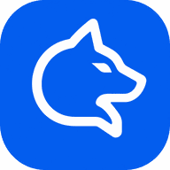

# Frappe Wolf: identity tokens

These are the tokens behind the making-of page and the Wolf UI. Copy them as they are.
Every text pair below meets WCAG AA (4.5:1) on its own background. The ratios were checked
when the palette was rebuilt around the official logo.

## The mark

The founder designed the mark, and it is used as supplied. It is a wolf head in profile, drawn as
a **single continuous white line**: two pricked ears, a long muzzle and an open jaw. One
**angular eye slit** makes the eye. The head sits on a **rounded square** of electric blue
`#035AEC`. The master file is `docs/logo.png` (1254 px).

| Asset | File | Use |
|---|---|---|
| 512 px, transparent corners | `assets/logo-512.png` | Hero, documents |
| 192 px | `assets/logo-192.png` | Nav, touch icon, PWA |
| 32 px | `assets/favicon-32.png` | Favicon (also used at 16 px) |
| 1200×630 | `assets/og-1200x630.png` | Social sharing (logo on Nuit) |

- **Clear space:** at least 25% of the tile's width free on every side.
- **Minimum size:** 24 px in UI. The 16 px favicon is the only exception. Below 16 px the eye slit closes.
- **Don't:** recolour the tile or the line, remove or outline the square, stretch, rotate, add effects
  inside the tile, place it on busy photography, or redraw or trace it as a "simplified" SVG.
  A soft outer shadow tinted with the brand colour is allowed on hero surfaces.

## Colour

### Brand

| Token | Light | Dark | Use |
|---|---|---|---|
| `--wolf-brand` | `#035AEC` | `#035AEC` | Logo tile, primary buttons, brand fills. White on it is 5.7:1 |
| `--wolf-on-brand` | `#FFFFFF` | `#FFFFFF` | Text and icons on brand fills |
| `--wolf-brand-text` | `#035AEC` | `#7FA8FF` | Links, focus rings, accents on the background (5.1:1 / 8.2:1) |

Blue is the only saturated colour that belongs to the brand. Severity colours never use it.

### Neutrals: "Nuit" and "Os"

| Token | Light (`Os`) | Dark (`Nuit`) | Use |
|---|---|---|---|
| `--wolf-bg` | `#F4F2EC` | `#0A0F1C` | Page background |
| `--wolf-surface` | `#FFFFFF` | `#131A2A` | Cards, timeline rail |
| `--wolf-line` | `#DCD8CE` | `#283147` | Hairlines, borders (decorative) |
| `--wolf-ink` | `#121725` | `#ECEEF3` | Body text (16.0:1 / 16.5:1) |
| `--wolf-muted` | `#565D6B` | `#A2AABA` | Secondary text (5.9:1 / 8.2:1) |

### Severity: moon phases

Each severity has a colour and a shape. Never show the colour without the glyph.

| Severity | Token | Light | Dark | Glyph | Meaning |
|---|---|---|---|---|---|
| `info` | `--wolf-info` (*Lune*) | `#6B4FA0` | `#BBA6E6` | ○ new moon (outline) | The wolf hears something. |
| `warning` | `--wolf-warning` (*Ambre*) | `#8A5200` | `#F0B04A` | ◐ half moon | One eye opens. |
| `critical` | `--wolf-critical` (*Braise*) | `#B0281C` | `#FF7466` | ● full moon (filled) | The howl. Someone wakes up. |
| resolved | `--wolf-ok` (*Mousse*) | `#2E6B4A` | `#7CC79E` | ✓ tick in a ring | Back to sleep. |

Light values are ≥ 5.6:1 on `#F4F2EC`. Dark values are ≥ 6.5:1 on both `#0A0F1C` and `#131A2A`.

**Why info is lilac:** a blue `info` placed next to `#035AEC` reads as brand or link. Moonlight
lilac stays calm and cool, ranks below amber and ember in loudness, and never looks clickable.
**Amber** now means only `warning`. It is not a brand colour.

## Typography

| Role | Family | Notes |
|---|---|---|
| Display | **Instrument Serif** (400, italic) | Headlines on storytelling surfaces |
| Text/UI | **Inter Tight** (400/500/600) | Body, labels, tables |
| Data | **JetBrains Mono** (400/500) | Timestamps, log lines, metric values, IDs |

Inside Desk, the Frappe UI keeps Frappe's own font and only adds the mono face for timestamps
and values.

Type scale (1.25, base 17px on screen):

| Step | Size | Use |
|---|---|---|
| −1 | 0.8rem | Captions, mono metadata |
| 0 | 1rem / 1.6 | Body |
| 1 | 1.25rem | Lead, card titles |
| 2 | 1.56rem | H3 |
| 3 | clamp(1.9rem, 4vw, 2.6rem) | H2 |
| 4 | clamp(2.8rem, 9vw, 6.5rem) | Hero, display serif |

Timestamps are always `HH:MM` in mono, with tabular figures.

## Voice

1. **State, don't dramatise.** Write "502 on a.example.com, 14 in 5 min, after a deployment at 01:47."
2. **Lead with scope.** Site, then bench, then host.
3. **Numbers over adjectives.** "count ≥ 10 in 5 min" beats "a lot of errors".
4. **One wolf metaphor per screen, at most.** The brand is the wolf. The product is a tool.
5. **Night-shift kindness.** Keep alerts short and put the link last. No double exclamation marks.
6. **Names:** *Frappe Wolf* (the product), *Wolf Agent* (the host daemon), *Wolf App* (the Frappe
   app). DocTypes keep their technical names.
